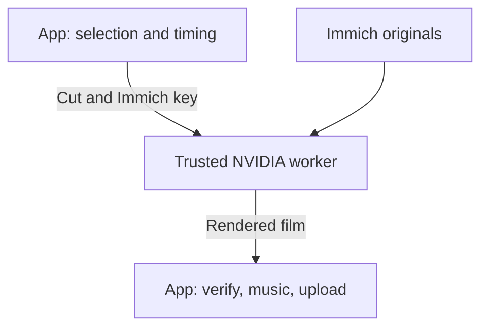

# Render on a GPU box

On a plain NAS the render is the long part of every run: what the editor read is banked, the
encode is not, so a second cut of the same month still encodes the whole film on the NAS's cores.
The render worker takes that one stage to a machine with an NVIDIA card. Selection stays on the
NAS, and so does the upload back to Immich. Music generation stays with its configured backend;
Demucs stem separation can share the inference worker.

The [combined CUDA worker](../run/reference-setup.md#one-gpu-service) puts this render service,
picture inference, captions and Demucs in one container on port 8092. Its render URL ends in
`/render`; the standalone setup below keeps port 8093.

The render API requires a bearer token, including its health endpoint. The combined worker's
inference, caption and stem routes are unauthenticated. Bind the service to loopback when the app
runs on the same machine; otherwise use a private network and firewall rules that allow only
the app. Keep these ports off the internet.



## What it holds

Every job carries the app's own Immich API key, the same one with the same permissions, so the
worker can fetch the selected originals itself. It keeps the key in memory for the job and redacts
it from its messages, but anyone who controls the worker process can read it. Run the worker
somewhere you trust as much as the NAS. If the app never uploads back, give it a read-and-download
key, and that is then all the worker holds.

## Set it up

Use the same app version on both sides: the app refuses a worker on another version before it
sends any footage. On the GPU box, with the NVIDIA container toolkit installed, copy
[`services/render-worker/compose.yaml`](https://github.com/sam-dumont/immich-memories/blob/main/services/render-worker/compose.yaml)
into an empty directory with this `.env`:

```bash
IMMICH_MEMORIES_IMAGE=ghcr.io/sam-dumont/immich-memories:YOUR_APP_TAG
IMMICH_URL=https://photos.example.com
RENDER_WORKER_TOKEN=replace-with-openssl-rand-hex-32
RENDER_BIND_ADDRESS=192.168.1.50    # the worker's LAN address; 127.0.0.1 behind a reverse proxy
```

The worker refuses to start with a token under 32 characters or one with a placeholder word like
`change-me`; `openssl rand -hex 32` gives one that passes. `docker compose up -d` starts it on port 8093. For Kubernetes the same folder has
`kubernetes.yaml`: it wants a Secret with `token` and `immich-url`, one NVIDIA device and the
`nvidia` runtime class. Every worker setting is in the
[worker's README](https://github.com/sam-dumont/immich-memories/tree/main/services/render-worker).

Then on the NAS:

```yaml
render:
  worker_base_url: http://192.168.1.50:8093
  worker_token: ${RENDER_WORKER_TOKEN}
  allow_insecure_http: true
  fallback_to_local: false
```

The request carries your Immich key. The example explicitly trusts this private LAN with
`allow_insecure_http: true`. For HTTPS, configure a reverse proxy, use its URL and omit that opt-in.

On Kubernetes, `deploy/kubernetes/overlays/render-sidecar` runs the worker as a second container
in the app's own pod instead of its own Deployment: the two share a network namespace, so the app
reaches it at `http://127.0.0.1:8093`, loopback, with neither HTTPS nor
`render.allow_insecure_http` needed. See
[the Kubernetes page](../run/reference/kubernetes-operations.md#render-worker-as-a-sidecar).

## How long a render may take

A worker spends most of its time animating photos and encoding, so a long film takes far longer
than a short one. On a 4-CPU worker with an entry-level NVIDIA card, a photo takes 20 to 25
seconds to animate and the encode runs at about a third of real time: a one-minute month film
takes about 11 minutes, a ten-minute film with 150 clips about an hour and a half.

The card encodes, renders the titles and cuts the photo moves. Crossfades and captions run on
the worker's CPU, so its CPU limit sets the pace more than the card does. A one-minute, 13-clip film
kept about four cores busy on average for its 75 seconds of assembly, with peaks above that.
Give the worker 8 CPUs, or at least 6: under a 4-CPU limit, long films kept it throttled in 44% of
its scheduler periods. The worker sizes its FFmpeg, OpenCV, OpenMP and BLAS thread pools from that
limit. The standalone worker manifest and the sidecar component request 2 CPUs and set an
8-CPU limit.

Both sides size their deadline from the film itself: 60 seconds per clip plus 10 seconds per
second of film, capped at 12 hours. The app's `render.timeout_seconds` and the worker's
`IMMICH_MEMORIES_RENDER_WORKER_JOB_TIMEOUT_SECONDS` (both 3,600 seconds by default) are the least
any film gets, so a short film keeps the hour and a 155-clip, ten-minute film gets about four and
a half hours. Raise either setting only when your worker is slower than that or its queue is long:
the app's wait includes the queue and the download.

A render that stops moving fails sooner: when a running job reports no progress for 20 minutes,
the app stops waiting and says so. An app timeout does not cancel an active worker job.

Active rendering keeps ownership of its scratch workspace after a deadline. A stuck native
renderer can still require a worker restart. Increasing the deadline does not stop that job.

The worker receives the app’s map-tile and geocoding switches with the cut. Enable them in the
app’s [network settings](../run/privacy.md) when the film needs maps or place names.

The geocoding server is the worker's own choice, never the job's. The worker ignores the app's
`network.geocoding_url` and geocodes only through
`IMMICH_MEMORIES_RENDER_WORKER_GEOCODING_URL`, a self-hosted Nominatim such as
`http://nominatim.lan:8080`. Unset, the default, the worker does not geocode at all, even when
the app has `network.geocoding: true`; the film keeps the place names Immich gave.

## Check it

In Docker, prefix `immich-memories` commands with `docker compose exec immich-memories`
from the app's installation folder.

```bash
immich-memories preflight -v
curl -H "Authorization: Bearer ${RENDER_WORKER_TOKEN}" http://192.168.1.50:8093/health
```

It reports the worker's reachability, version, CUDA titles and encoders. The worker's own
`/health` says `accelerated: true` only when the CUDA title kernels and NVENC both opened; false on
a box with a card usually means `NVIDIA_DRIVER_CAPABILITIES` lacks `video`
([NVIDIA prerequisites](../run/hardware.md#nvidia)).

The worker logs each job to its own stderr, so `kubectl logs` or `docker compose logs` shows it.
`IMMICH_MEMORIES_LOG_LEVEL` sets the level, `INFO` by default. Two lines are worth looking for after
a film comes back short or slow: `Frame underrun`, a clip that ran out before its slot ended and was
held on its last frame, and `Photo move on the CPU`, a still the card could not take.

## What to expect

- A worker failure fails the run. `fallback_to_local: true` renders the same cut on the NAS instead
  and says so.
- A worker that can't open NVENC still renders, in software, and reports it on `/health` and in the
  job record. A dropped clip is a failed job, never a different film.
- Worker output is H.264 or H.265 MP4. MOV and ProRes require `fallback_to_local: true`
  to render on the app host; with the example's `false`, those requests fail.
- When the film the NAS downloads matches the worker's digest, the NAS keeps the worker's decode
  check instead of decoding the film again, unless music was mixed in.

Use [Measure your setup](./measured.md) to compare a local render and a worker using the same cut.
