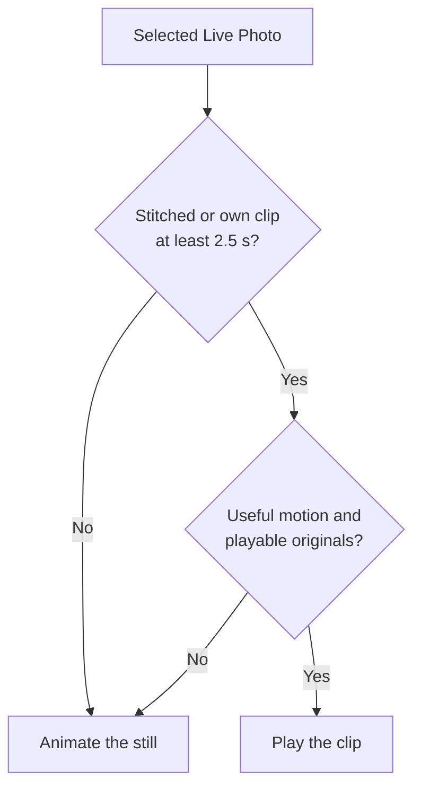

import Video from '@site/src/components/Video';

# Photos, Live Photos and HDR

Photos and videos share one cut. A selected still gets a gentle zoom and pan; a video plays the interval the cut chose. You can remove either or swap it during review.

## Ken Burns, and where the pan lands

A still with people in it moves between the whole picture and a close-up, so you see the full photo at one end and the point of it at the other. A still with nobody in it drifts instead.

- **A film about one person** opens on the whole picture and pushes in on that person, 25 to 35 %. Other faces stay if they still fit; the person always does.
- **A film about several people, or several faces in any other film**, closes on the tightest crop that keeps every face, with some air around each head, up to 50 %. When the faces already span the picture, it pans across them at a 20 % zoom instead, so everyone is on screen at some point.
- **Any other film** zooms in or out (each photo always the same way) toward its one face.
- **A picture with nobody in it** (a landscape, a building, a plate), in any film, mostly pans gently along its long side at a 12 to 15 % zoom: sideways for a wide picture, up or down for a tall one. Now and then it zooms softly instead, by the same small amount.

The face boxes come from Immich. Rendering does not run another face detector.

If you crop, rotate or mirror a photo in Immich's own editor, the film uses that edited version, not the untouched original. An edited HDR photo comes out in SDR: Immich's editor does not carry the gain map over. Selection judges the edited version too, so a crop that cut someone out is read without them. Videos and Live Photos always play from their original: Immich's editor doesn't touch them.

Clips keep their whole frame. For a landscape clip in a portrait film, choose **Blurred background** or **Fit with bars** under **Scaling Mode**. Neither crops your subject.

To make a video-only film, untick **Include photos** under **Length and pictures**, pass `--no-photos` on the CLI, or set `photos.enabled: false` in YAML.

## Live Photos

A Live Photo enters the cut as one photograph. Nearby Live Photos are stitched into one clip, and that clip plays as motion when it lasts at least 2.5 seconds and really moves. A lone Live Photo plays its own clip by the same rule. Anything shorter plays as its still, with the same zoom and pan as any photo: a 1.2-second clip is half a sentence, while a 2.9-second one carries a moment.

The app verifies selected motion companions before sealing the cut: a malformed video keeps the photograph as a still, while unavailable sources or tools stop the check. When a burst cannot be stitched, the kept picture's own clip gets the same 2.5-second test, and the still otherwise. `runs story` and `runs why` say when a Live Photo was held as its still, and why. A Live Photo you add during review is stitched with its neighbours and decided the same way.

Album films use the same Live Photo handling as date, people and event films. Add the
photographs to your album; the app reads their linked videos automatically. Those videos support
the photographs and do not appear as separate clips. A companion that Immich reports as missing
leaves a still and a warning; a failed connection stops the run.

Three overlapping Live Photos can become this continuous 4.5-second shot:

<Video title="Three overlapping Live Photos of a hilltop, merged into one shot" poster="/img/live-photo-preview.jpg" src="/demos/live-photos/italian_hilltop/merged.mp4" width={480} controls />

Six Live Photos at a bike race become 8.1 seconds:

<Video title="Six Live Photos at a bike race, merged into one shot" src="/demos/live-photos/bike_race/merged.mp4" width={480} controls />

These examples are the author's own footage, published with permission.

Untick **Include Live Photos**, pass `--no-live-photos`, or set `advanced.analysis.include_live_photos: false` to use the stills only. A person-filtered film does not add untagged pictures just to extend a burst.

## HDR, end to end

Plain photos use an SDR H.264 clip during preparation, with hardware encoding when available. Gain-mapped HDR photos keep HDR only when the film uses HDR H.265; an SDR film tone-maps them during preparation. Software H.264 uses CRF 18 for these clips.

On the Basic tier, Live Photo merges are limited to 1080p. With automatic HDR output, a device with hardware H.264 but no hardware HEVC tone-maps HDR photos and companions to SDR during preparation. An explicit HDR output keeps photo HDR through software HEVC.

Use [hardware encoding](../run/hardware.md) to check what your machine supports. The [media processing reference](../reference/media-processing.md) covers frame verification, audio alignment, supported devices, HDR formats and gain maps.
