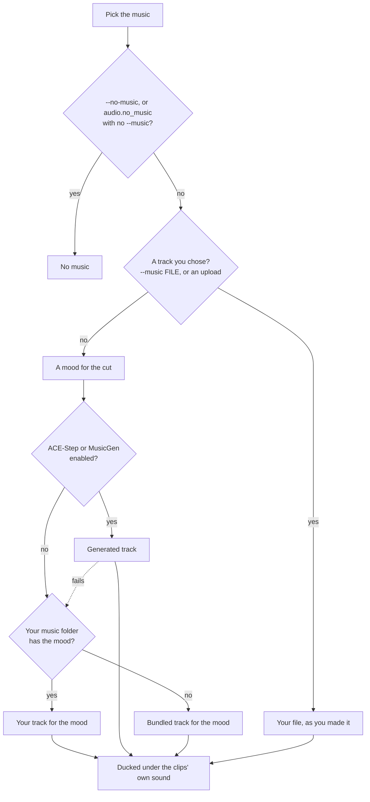

# Titles, maps and audio rendering

The cards around the clips are what make a film read as a memory instead of an FFmpeg concat of your
camera roll:

- **Intro card**: a blurred, darkened frame from the first clip behind white text, 3.5 seconds. Title and
  subtitle shrink together when the pair would pass 80 % of the frame height.
- **Month dividers**: at each month change in a single-year film spanning four months or more. The first
  month gets none: the intro already said it. A month needs at least 2 clips in the cut for a card. When not every card fits, the film keeps as many as do,
  picked by clip count (ties go to the earlier month), so a busy November keeps its card and a thin March
  loses its. A tight film never drops to zero while one card still fits.
- **Trip map**: a satellite fly-over from home to the destination, in place of the intro. Off by default, see
  [The map fly-over](#the-map-fly-over).
- **Location cards**: the place name where a trip moves on. A hop of more than 30 km to a different
  place gets one. A walking or cycling trip moves village to village well under that, so a change of town
  gets one too: at most one a day, never the same town twice in a row. Home follows the same rule. With
  map tiles on, each card flies from the town the last card named to the new one, then holds on its name.
  See [Map moves](#map-moves).
- **Ending**: a fade to `title_screens.fade_color` (`white` by default, or `black`), no text. Every film
  keeps it; a short film squeezes it to 2 s rather than dropping it.

All of this works on a plain NAS. Titles come from templates, the special-day catalogue and your album
names. A model writes a title only when you opt in ([When a model names the film](#when-a-model-names-the-film)).

A configured LLM picks the music mood from the cut's text on every tier, Basic included. It gets no
pictures and needs no local GPU. If the model is missing or fails, the facts pick the mood instead.
Configuring a text model doesn't make it caption pictures.

`title_screens.enabled: false` turns every card off. The other keys are in the
[config reference](config-reference.md#title-screens).

## Styles

Every title is Montserrat, white on a dark palette. The date and place captions burned on clips use Outfit.
Both ship inside the package (OFL-1.1).

| Style | Palette | Character |
|-------|---------|-----------|
| `modern_warm` | Warm charcoal/stone | Semibold. Amber accents |
| `elegant_minimal` | Deep navy/black | Clean, medium weight. Cyan accents |
| `vintage_charm` | Warm charcoal | Nostalgic. Amber/gold accents |
| `playful_bright` | Deep teal | Energetic, semibold. Teal accents |
| `soft_romantic` | Dark amber-tinted | Gentle scale-in. Warm amber accents |

`style_mode: auto` (the default) picks the palette from the film's mood: happy, nostalgic and romantic get
`warm_dark`, calm and peaceful `deep_teal`, energetic and playful `midnight`, exciting and any other mood
`cinematic_dark`.
`style_mode: random` picks a named style. Set `title_screens.style_mode: elegant_minimal` to choose one
explicitly; all five names in the table are accepted. In the web UI, use **Render → Title style**.

The renderer is picked for you: GPU kernels where Metal, CUDA or Vulkan start. On a CPU or a NAS, Pillow
draws the background and text once, and FFmpeg slides, scales and fades the text at the film's frame
rate. Font, layout and palette stay the same. Bokeh, moving gradients and animated deblur need a GPU;
hardware video encoding still works on the NAS. See [Hardware encoding](../run/hardware.md#title-kernels).

Preview a title card without selecting a film:

```bash
immich-memories titles test --year 2025 --style elegant_minimal
immich-memories titles test --month 6 --year 2025 --type month
immich-memories titles test --year 2025 --locale fr --orientation portrait
```

## Script and font coverage {#every-alphabet}

Montserrat draws Latin, Polish, Czech, Turkish and Vietnamese included. A letter it lacks comes from Noto
Sans, word by word, so `DEUX SEMAINES EN CRÈTE · Κρήτη` keeps its French in Montserrat and its Greek in Noto.
A word never switches typeface halfway through.

| Script | Where the font comes from |
|---|---|
| Latin, Greek, Cyrillic, Vietnamese | inside the package (Noto Sans) |
| Arabic, Hebrew, Thaana, the Indic scripts, Sinhala, Thai, Lao, Khmer, Myanmar, Armenian, Georgian, Ethiopic | `titles fonts --install` (3.8 MB for all of them) |
| Chinese, Japanese, Korean | `titles fonts --install` (Noto Sans CJK, 39.5 MB) |

The Docker image runs that install at build time, each file checked against a pinned SHA-256, so a Docker
user has the listed script fonts out of the box. On pip or uv, run it once:

```bash
immich-memories titles fonts --install
```

That command is the only thing that ever downloads a font. A render never does: a letter no installed font
has draws as a box, and the log names the command once. Where the files come from is on
[Privacy](../run/privacy.md).

Arabic and Hebrew run right to left and Arabic letters join; the Indic scripts form their clusters. That is
HarfBuzz and FriBiDi through Pillow. The Docker image has both. Elsewhere, install FriBiDi from the system
(`apt install libfribidi0`, or `brew install fribidi` and start the app with
`DYLD_FALLBACK_LIBRARY_PATH=/opt/homebrew/lib`). Without it the letters still draw, unjoined.

Greek in capitals drops its stress accents, the way Greek signs print it (`ΗΡΑΚΛΕΙΟ`, and `ΜΑΪΟΣ` where the
accent kept two vowels apart). Chinese characters use the Simplified forms unless the title holds kana
(Japanese forms) or Hangul (Korean).

## Languages

`title_screens.locale` sets the language of everything the film prints: titles, months, weekdays, trip cards,
holidays. `auto` (the default) follows the host's `LC_ALL`, `LC_MESSAGES`, `LANG` or `LANGUAGE`, and on a Mac
with none of those set, the macOS language setting. The Docker image sets none of them, so a container always
renders English on `auto`; set `title_screens.locale: fr` (or `LANG=fr_FR.UTF-8` on the container) for a
French film.

A film whose window is exactly a meteorological season opens on the season's name (`Summer 2025`, `Été 2025`,
`2025年の夏`), counted in your home's hemisphere: with `trips.homebase_latitude` south of the equator, 1 December to
the end of February is `Summer 2024–25`. Without a home base, or for any other window, the months name it (`June to
August 2025`).

The web UI's suggested title is the same template in the same language, so with no reader a French trip made
in the web UI opens on "DEUX SEMAINES EN CRÈTE, GRÈCE, ÉTÉ 2025", exactly as the CLI would.

| Language | Code | Trip titles |
|---|---|---|
| English | `en` | full: "A WEEK IN THE NETHERLANDS" |
| French | `fr` | full: "UNE SEMAINE AUX PAYS-BAS" |
| Dutch | `nl` | full: "op Kreta", "in de Verenigde Staten" |
| German | `de` | full: "auf Kreta", "in der Schweiz" |
| Spanish | `es` | full: "en el Reino Unido" |
| Italian | `it` | full: "a Creta", "negli Stati Uniti" |
| Portuguese (Brazil) | `pt-BR` | full: "na Itália", "nos Estados Unidos" |
| Portuguese (Portugal) | `pt-PT` | full: "em França", "no Japão" |
| Polish | `pl` | full for the places it lists, the fallback design for the rest |
| Swedish | `sv` | full: "på Kreta", "i Italien" |
| Russian | `ru` | fallback design |
| Japanese | `ja` | fallback design |
| Chinese (Simplified) | `zh-Hans` | fallback design |
| Korean | `ko` | fallback design |

:::caution[Twelve of these catalogues were drafted by an AI]
Month and weekday names come from CLDR for the selected locale. The rest of the wording lives in one
catalogue per language under `src/immich_memories/locales/`. English and French are written by hand. The
other twelve catalogues, and the preposition rules for Dutch, German, Spanish, Italian, Portuguese, Polish
and Swedish, were drafted by an AI and checked by tests, not yet by native speakers. Each file says so at the
top. A fix is a one-line pull request.
:::

"Fallback design" means the trip card never guesses a preposition: the place is the big line, the duration and
date sit under it. A wrong preposition never reaches the screen.

Corrections and new language catalogues are welcome, native-speaker review of the AI-drafted ones most of all.

## Trip titles: the place at the right scale

A trip is named after the smallest place that holds 85 % of its located pictures, counted per picture: the
city, else the island, else a town holding more than half of a local stay (under 25 km across), else the
region, else two regions, else the country, else the countries in the order you crossed them.
A day with forty pictures in one town weighs more than a travel day with two.

The places are Immich's own reverse geocoding (GeoNames, offline) plus a small bundled table of islands,
because GeoNames files most islands under a region. No outside call.

| Scale | English | French |
|---|---|---|
| A country | `IN THE NETHERLANDS`, `IN ITALY` | `AUX PAYS-BAS`, `EN ITALIE` |
| An island | `IN CRETE, GREECE`, `IN CYPRUS` | `EN CRÈTE, GRÈCE`, `À CHYPRE` |
| A region | `IN APULIA, ITALY` | `DANS LES POUILLES, ITALIE` |
| Two regions | `IN UTAH AND NEVADA, UNITED STATES` | `DANS L'UTAH ET AU NEVADA, ÉTATS-UNIS` |
| A city | `IN LAS VEGAS, UNITED STATES` | `À LAS VEGAS, ÉTATS-UNIS` |
| Several countries | `ACROSS BELGIUM → SPAIN` | no phrase, place first |

The full title adds the length and the season or month: `TWO WEEKS IN CRETE, GREECE, SUMMER 2025`.

Immich stores places in English. Country, island and region names are translated offline (CLDR and the
bundled tables), from either form of country name an Immich server stores ("The Netherlands" or
"Netherlands"). City names stay as Immich stored them unless you switch on `network.geocoding`, which asks Nominatim
for the city, town or village each picture is in, in the film's language. A place with no name in the film's
language, or in its base language, keeps its own local name: it is never shown in English. Answers are cached
for the next film. A Berlin visit stays Berlin across Mitte and Kreuzberg. The same name reaches story titles,
captions, location cards, map pins and the report. What that sends is on [Privacy](../run/privacy.md).

## Date and place captions

Every film gets small translucent date and place captions unless you turn them off: `defaults.add_date`
and `defaults.add_place` are on, and `--no-add-date` or `--no-add-place` drops one for a single film (the
web render panel has the same two boxes). They are 48 px on a 1080p frame at 85 % opacity, each one
appearing when it changes. Captions stay clear of dissolves so two never overlap, and a caption in any
alphabet draws with the title fonts above, HDR included. On an FFmpeg built without the `drawtext`
filter, captions are drawn as images instead; a caption no installed font can draw is left out, with a
warning.

The date says only what is new: the weekday and day inside one month, the day and month inside one year, the
full date across years. Each language writes it its own way (`10. AUGUST`, `10 DE AGOSTO`, `10 SIERPNIA`,
`8月10日`).

Place captions show the city, town or village, including at home and at familiar places. A repeated label
stays quiet until the place changes; returning to a city names it again. No library-history scan
is needed. When the home country is known, its name stays hidden. Abroad, the country appears
on entry unless the opening title already names it, then stays quiet until the country changes.
Country names use the film's language.

Near the configured home base (within 10 km), captions can name the district, such as Montmartre in Paris.
Away from home, a district covering at least 85 % of a stay's pictures keeps its name; excursions keep
their own labels. When all known districts agree, missing district data does not erase those local labels.
Visits spread across districts use their shared locality. Different towns and visits separated by more
than `trips.max_gap_days` do not rename one another. The selected clips retain the names resolved from the
full source window. Streets and points of interest stay out of captions. A country disagreement keeps the
source label; failed lookups are retried on a later run. A Latvian, Lithuanian or Finnish municipality
label (`novads`, `pagasts`, `savivaldybė`, `seniūnija`, `kunta`, `kaupunki`) puts the town's name in
the genitive ("Helsingin kaupunki"), so it is not used as a name: the caption takes Immich's own city
for that picture ("Helsinki"), and only with no city from Immich does it fall back to the label
without its admin word ("Helsingin").

A few distant excursions don't turn a local stay into a regional trip: when at least 85 % of a stay's
located pictures fit in a 25 km group, the town they show keeps its name instead of a broader label from
the trip's centre point.

## The map fly-over

The fly-over needs satellite tiles from a third party, so it is off until you say so:

```yaml
network:
  map_tiles: true
```

Off, a trip film opens on the ordinary title card, location cards show the town name on the style's own
background, and nothing about where you went leaves the machine. On, the camera starts over home at city
zoom and flies to the first trip stop; later cards travel from the previous stop to the next one. Long
distances use a Van Wijk zoom (the d3 `interpolateZoom` path, which pulls out further the further apart
the points are), and hops that already fit the close view pan. The camera arrives close to the
destination, with the same framing at 1080p and 4K.

Tiles come from ArcGIS World Imagery at `server.arcgisonline.com`, no key. One map can need more than 1000
tiles, depending on the route and the resolution. A box that can't reach the server renders grey frames
and the run carries on.

### Map moves

Every map in a trip film is one move: an eased flight, then at least 2 seconds sitting still on the destination
with its name up. That goes for the intro and for each location card, the town-change cards of a walk
included. A card flies from the place the previous card named (the trip's first place for the first card) to
its own town, so a hike reads as village to village on the map.

A move lasts 6 seconds for a short hop and 8 for a long flight, scaled on the log of the distance: 30 km gets
6 s, 300 km about 7 s, 3000 km and more 8 s. The 2 s hold always stays; the flight gets the rest.

With animated backgrounds on, a card renders every flight frame once and the hold once, so a 7 s card at
30 fps is about 150 map renders. Tiles are cached for the whole card. The log line per card gives frames,
renders and tiles.

`preset: fast` sets `title_screens.animated_background: false`. Maps then use three views instead of the
smooth flight: close to the previous stop, the route's wider midpoint, and close to the next stop, joined
by short fades. Satellite detail renders at a 360-pixel short side and is enlarged; names and pins are
drawn at the film's full resolution. That is three map renders per leg. Resolution, frame rate, encoding,
move duration and the hold on the destination stay the same. Set `animated_background: true` explicitly
to keep the smooth flight with the fast preset.

### Stops on the intro

The intro lands on the first trip stop. Later stops appear as the film reaches them. Only named stops
get pins, since an unlabelled dot tells you nothing.

Close stops are grouped with the trip-leg rule: points that stay within 25 km of each other are one area of stay.

- A group of 1 or 2 stops keeps each town's own name.
- A group of 3 or more is one pin in its middle, named by the place its members share: the city, town, village, municipality,
  county, district, island, province or region, from the geocoder, in the film's language. With
  [geocoding](../run/privacy.md) off, or no level in common, it is named "first → last" (`Village A → Village G`). The arrow is bundled with the fonts and needs no
  extra font installation.

So a hike through seven villages in one valley is one stop with the valley's county on it, and the intro
flies there in one hop. It never hops stop by stop: each location card already flies that leg, and an
8-stop trip at 2 s a hop would open on 18 s of map before any picture.

### Maps and film length

Maps run on top of the length you asked for. The budget counts each map at the price of what it replaces (a
location card at 2 seconds, the intro at 3.5), so a 3-minute trip keeps its
3 minutes of pictures and regular cards, and the seconds the maps run past that are added on top. Three
location cards and an intro add about 20 s.

The render log says it once the film is composed:

```text
Final timeline: 163.5s content + 16.5s titles + 21.0s map extra
```

`immich-memories runs show <run-id>` prints the same line as **Timeline**, and
[`immich-memories report`](../make/cli/report.md) carries it under `run.timeline`.

## When a model names the film

Model-written titles are experimental and off by default. With a [reader](../better/reader.md) configured
and `title_screens.llm_titles: true`, the model names a special day from what the catalogue saw, and
writes the film's summary (the second half of its Immich description). `--llm-title` turns it on for one
run and adds trips; `--no-llm-title` keeps the app's title for one run. `--title` always wins.

Years, months, seasons, people, birthdays, holidays and "on this day" films are always titled by the app,
by what they are and when ("Kit's birthday · 2026", "Christmas · 2019–2025"), with no subtitle unless you
type one. An album film opens on the album's name.

The title reader gets facts, never pictures and never coordinates: first names, birth dates and ages, the
relations your [people registry](../get-started/who-is-who.md) confirms, the special-day catalogue's words, the
album that holds most of the cut, the cut's named stories and summary, and the place names by day. The
app refuses the model's title, and keeps the template, when it holds a capitalised word found in none of
those facts, a country, island or region the facts don't name (even as its first word), or misses a year
the template would show. A trip title has to name the trip's place. A refusal only costs a plainer
title, so the check leans towards refusing.

### Where the title came from

Every render stores the source of its opening title on the run. `immich-memories runs show <run-id>` prints it
as **Title From**:

| Source | The title is |
|---|---|
| `override` | what you typed: `--title`, or your edit in the web UI |
| `album` | an album film's album name |
| `occasion` | a holiday's name, or the special-day catalogue's title in an English film |
| `model` | what the title reader wrote |
| `place` | a trip title, built from where it went |
| `fallback` | the app's own: the period, the people, the birthday, the day across the years |

The special-day catalogue is stored in English. An English film shows the catalogue title verbatim
(`occasion`). Any other film sends that English title through the reader when model titles are on
(`model`), and otherwise uses a localized `"A day in {place}"` template (`fallback`). So editing a
catalogue title changes the film's title word for word only in English films.

`fallback` on a special day or a trip you expected the model to name means the reader wasn't asked (model
titles off, or no `--llm-title` for a trip), failed, or had its title refused.

## Music



The mood comes from facts and text, never pictures. Without a reader, or when its call fails, the film's
own facts pick it:

| The film | Starting mood |
|---|---|
| A year in review | inspiring |
| A holiday, a special day, or a birthday among its main stories | happy |
| A trip, or a trip among its main stories | happy |
| A visit or an event among its main stories | playful |
| A season | happy in summer, playful in spring, tender in autumn and winter |
| A person or group of people | playful |
| On this day | tender |
| Anything else (a month, an album) | playful |

From there the shots move it. When more than a third of the shots move (videos, Live Photos that
play), the mood goes one step livelier. It goes another step when a fifth carry music in their own
sound or 30 % show three or more people. The steps run calm, peaceful, tender, playful,
happy, exciting, energetic. An ordinary month of still photos with no music and no group gets
`calm`. A celebration or a trip in still photos steps down, but never below playful. The run's
"Music mood:" note names the facts it used.

With a reader configured, `mood_for_cut` sends the same facts and the saved cut's text (story labels,
captions of kept pictures) and gets back a mood, an energy, a tempo and up to five genres. The prompt
lists the moods from most to least energetic and keeps calm for still, quiet films. The season only
colours the caption ("warm, golden" in autumn); the mood sets the tempo.

A generated track's style comes from a per-mood table of how often each style was kept in listening
tests. Calm, tender, nostalgic, happy and energetic each have their own list over solo piano, lo-fi
hip hop, electronic, downtempo, neo-soul, post-rock, funk and city pop; the other moods use the
nearest of those five (playful, inspiring and uplifting use happy; peaceful uses calm; exciting and
dramatic use energetic; romantic uses tender; sad, melancholic and mysterious use nostalgic). A
style is sampled with weight (kept + 1) / (rated + 2), and left out of a mood when it was kept in
fewer than four takes out of ten. Electronic sits below that floor in both tables that list it,
so it never plays unless you ask for it. A reader's genre (piano, lo-fi, funk, post-rock, downtempo,
neo-soul, city pop) is followed when the mood's list allows that style; any other genre is ignored
and the table decides. Acoustic folk, jazz trio, indie rock, orchestral, ambient and metal are
never picked automatically.

A generated soundtrack is one piece, made by one backend and planned to the film's real length. A film
up to 82 seconds gets a single ACE-Step take, asked 8 seconds longer and cut at the last frame, so its
outro never plays over the ending card. A longer film gets up to 3 takes of at most 90 seconds that
share one caption, tempo and key, joined on a bar line with a 0.3 s crossfade and repeated to the film's
length.

A generator that fails falls through to a bundled track, and the swap shows up as a warning on the
finished video and in any completion notification, so a dead backend never passes for working music.

The bundled tracks come with the `music` extra, which the Docker image and the `all` extra include: 28
royalty-free tracks in five moods (calm, energetic, happy, nostalgic, tender), about 30 s each, generated
locally with ACE-Step from nothing sampled. Tempo, key and seed per track are in `LICENSE-MUSIC`. A pip
install without the extra renders silent unless you pass a file or fill your own music folder.

In a film with photos, the pick prefers a track whose beat lands within 0.2 beats of the photo cadence.
A film plays that one track from start to end, and a track from your music folder works the same way.
When the film is longer than the track, the track loops onto itself: each pass starts on its first
downbeat, and the pass before ends where the next 3 seconds sound most like what follows that downbeat,
so beat and chords carry on across a 0.3 s crossfade. A 30 s track usually loops every 12 to 25 seconds.
The music fades out over the film's last 2 seconds.

Ducking is a sidechain compressor keyed on the clips' audio, so speech, laughter and wind all lower the music.
`--music-volume` (0.0 to 1.0, default 0.5) maps onto -20 dB to 0 dB before ducking. When a generator gave
four stems, vocals duck most and drums keep their rhythm. For a clip whose own sound is music or singing,
the soundtrack steps aside for the whole clip. None of the ducking constants is a config key.

The final mix stays under a -2 dBFS true-peak ceiling, so the AAC encode doesn't overshoot and clip.

| Where | Switch |
|---|---|
| CLI | `--music PATH`, `--no-music`, `--music-volume` |
| Web UI, Render | **Music**: Automatic (as configured), No music, a previewed track, an uploaded one, and **Music volume** |
| Config | `audio.no_music`, `audio.local_music_dir`, `advanced.ace_step.enabled`, `advanced.musicgen.enabled` |

### Generated music {#install-locally-on-a-mac}

Generated music (ACE-Step on a Mac or a GPU box, MusicGen on a server) is an add-on with its own install and
memory needs: [Generated music](../better/music.md).

### The music commands

```bash
immich-memories music search --mood happy --genre acoustic --limit 5
immich-memories music add compilation.mp4 output.mp4 --music ~/Music/track.mp3 --fade-in 3 --fade-out 5
immich-memories music add compilation.mp4 output.mp4 --mood nostalgic
```

`music search` reads `audio.local_music_dir` (`~/Music/Memories`), the folder films pick your own music
from. `music add` mixes a track under a video you already have, with the same ducking. Without `--music`
it picks a track from that folder by `--mood`, `calm` when you give none. No command here sends a frame to
a model: pictures are read once, at ingest. To hear what a saved cut would get before you render it,
`music preview RUN` generates its track ([runs render](../make/cli/runs.md#runs-render)).

`music search` exits 1 when no track matches, and `music add` exits 1 when the mix fails. Every flag is
in the [CLI reference](cli-reference.md#music).
